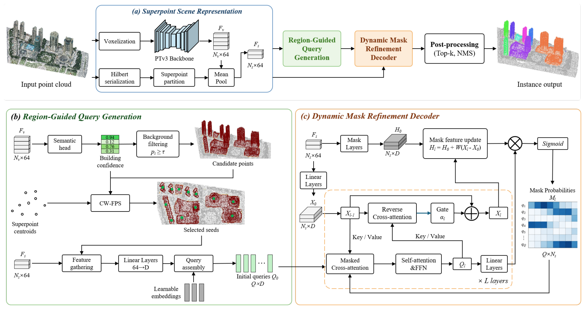
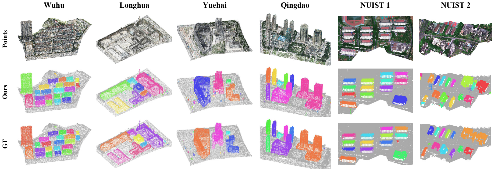
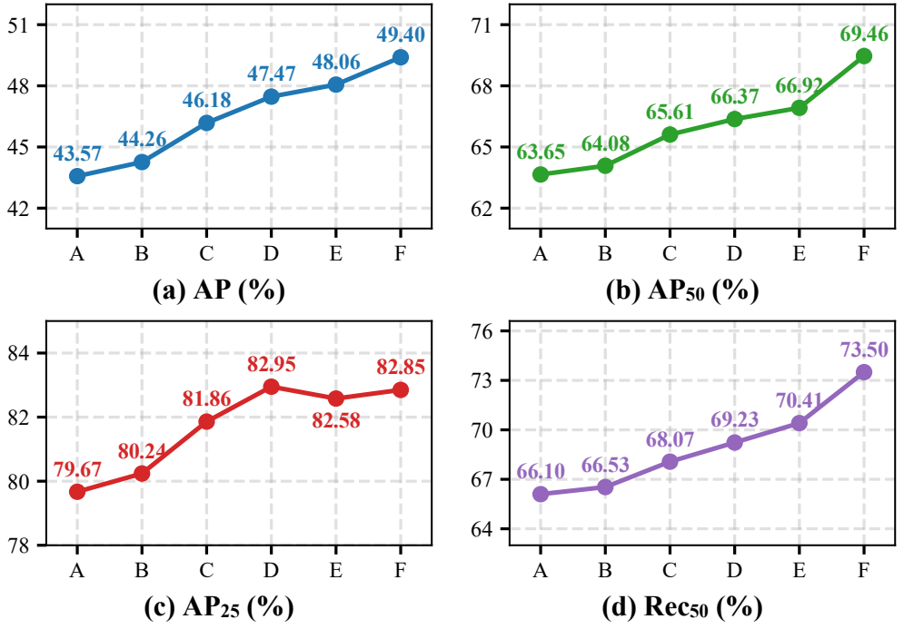
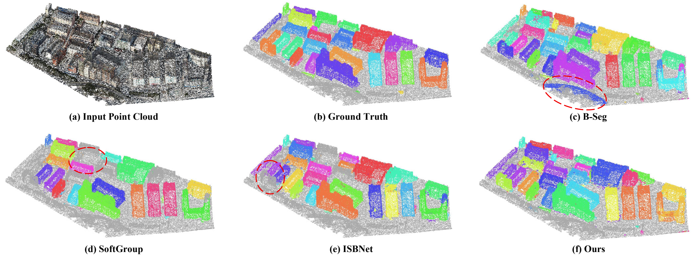

# BRQ-DMRNet

**Building Instance Segmentation in Airborne Point Clouds via Region-Guided Queries and Dynamic Mask Refinement**

Yufu Zang, Zhuokai Shi, Zhihao Huang, Haiyan Guan

## Overall Workflow



*Figure 1. Overall architecture of BRQ-DMRNet. RGQG employs semantic filtering and confidence-weighted farthest point sampling to distribute queries across likely building regions. Cascaded DMR decoder layers jointly update instance queries and superpoint features via bidirectional attention. Finally, the predicted superpoint masks are mapped back to the input points to yield building instances.*

The input points are serialized along a 3D Hilbert curve into fixed-capacity superpoints, while a Point Transformer V3 backbone encodes the voxelized cloud; the voxel features are mean-pooled per superpoint to obtain $F_s \in \mathbb{R}^{N_s \times 64}$. Region-Guided Query Generation (RGQG) then initializes the instance queries, and a six-layer Dynamic Mask Refinement (DMR) decoder jointly updates the queries and the superpoint features before the superpoint masks are mapped back to the points.

## Introduction

Extracting individual buildings from airborne point clouds is fundamental to urban mapping, digital twins, and building information modeling. Airborne point clouds acquired via UAV photogrammetry or LiDAR cover buildings across a wide range of scales and are frequently accompanied by dense vegetation and incomplete facade observations. Closely spaced buildings are particularly challenging to separate when local boundary cues are weak: omitted buildings leave gaps in urban maps, whereas over-merged instances obscure individual building identities.

Query-based methods predict instance masks from learnable queries, but with a fixed query budget, sampling across the full scene can leave small or sparsely sampled buildings with few seeds. They also update the instance queries at each decoder layer while keeping the scene features fixed, so adjacent roofs with similar geometry keep sharing the same local features even as the queries gather information about individual buildings. BRQ-DMRNet addresses both limitations:

1. **Region-Guided Query Generation (RGQG)** — filters superpoints with a pretrained semantic head and selects spatially dispersed seeds from the remaining candidates with confidence-weighted farthest point sampling (CW-FPS). Seeds are gathered from high building-likelihood regions instead of the whole scene, so small and sparsely sampled buildings are no longer starved of queries.
2. **Dynamic Mask Refinement (DMR)** — propagates intermediate instance hypotheses back into the superpoint features via a gated residual update, enabling joint, bidirectional refinement of both instance queries and superpoint features across decoder layers.

## Environment Requirements

The experiments were conducted on an NVIDIA RTX 3090 GPU with 24 GB of memory, using Python 3.10, PyTorch 2.x and CUDA 12.x. Besides PyTorch, the implementation depends on `torch_scatter`, `scipy` and `numpy`; superpoint features are produced by a Point Transformer V3 backbone, and the superpoint assets follow a Pointcept-style scene layout.

Training settings reported in the letter:

| Setting | Value |
| --- | --- |
| Voxel size | 0.2 m |
| Superpoint capacity $k$ | 16 |
| Number of queries $Q$ | 150 |
| Decoder feature dim $D$ | 384 |
| Decoder layers $L$ | 6 |
| Confidence threshold $\tau$ | 0.5 |
| Loss weights $\lambda_{cls}$ / $\lambda_{bce}$ / $\lambda_{dice}$ | 0.5 / 1.0 / 1.0 |
| Optimizer | AdamW, lr $1\times10^{-4}$, batch size 4 |
| Epochs | 200 |

The repository is organised as follows:

```
src/       model implementation
  brq_dmrnet.py      network wrapper: superpoints, RGQG candidates, mask mapping
  decoder.py         DMR decoder (masked cross-attention, reverse attention, mask head)
  query_sampling.py  candidate set and CW-FPS
  loss.py            Hungarian matching and the classification / BCE / Dice objective
  misc.py, nms.py    helpers
scripts/   data preparation utilities
assets/    figures used in this README
```

## Data

**The full training code and the processed data will be released after the paper is accepted.**

We evaluate BRQ-DMRNet on two datasets acquired from different modalities:

| Dataset | Platform | Characteristics | Points (M) |
| --- | --- | --- | ---: |
| UrbanBIS | UAV photogrammetry | Diverse urban scenes; varied building scales | 19.19\* |
| NUIST | Airborne LiDAR | Campus buildings; surrounding vegetation | 19.74 |

\*UrbanBIS point count at 10% retention.

We adopt the official UrbanBIS split (145 training and 48 test regions) and partition NUIST by region (8 training and 2 test regions). UrbanBIS is randomly downsampled to 10% of its original points before tiling; each region is then partitioned into 150 m × 150 m tiles with a 75 m stride (50% overlap), yielding 1,636/656 and 382/99 training/test tiles for UrbanBIS and NUIST, respectively.

The three preparation steps are independent and can be re-run safely — outputs are validated against the source coordinates and skipped when already consistent:

```bash
# 1. Uniform downsampling of the raw scenes (UrbanBIS: ratio 0.1)
python scripts/downsample.py \
  --dataset_root <raw_root> --output_root <downsampled_root> --ratio 0.1

# 2. Fixed-capacity Hilbert superpoints (paper setting: k = 16, grid 0.2 m)
python scripts/preprocess_superpoints.py \
  --dataset_root <downsampled_root> --output_root <superpoint_root> \
  --points_per_superpoint 16 --grid_size 0.2

# 3. Per-scene training assets (coord / color / segment / instance / superpoint)
python scripts/prepare_scene_assets.py \
  --dataset_root <downsampled_root> --superpoint_root <superpoint_root> \
  --output_root <asset_root>
```

## Modeling Results

Table II reports the quantitative results obtained with separate models trained for each dataset. BRQ-DMRNet reaches **49.40% AP** on UrbanBIS and **54.04% AP** on NUIST.

| Dataset | AP (%) | AP50 (%) | AP25 (%) | Rec50 (%) |
| --- | ---: | ---: | ---: | ---: |
| UrbanBIS | 49.40 | 69.46 | 82.85 | 73.50 |
| NUIST | 54.04 | 90.93 | 95.41 | 89.55 |



*Figure 2. Qualitative results on UrbanBIS and NUIST. The predicted masks separate the repetitive residential blocks in Wuhu and the closely packed towers in Qingdao, while preserving complex footprints in Longhua and Yuehai; on NUIST both the major campus buildings and the smaller auxiliary structures remain cleanly delineated under surrounding vegetation.*

### Ablation Study

Six configurations are compared on UrbanBIS under identical training settings and a fixed budget of 150 queries: **A** learnable queries, **B** FPS on all superpoints, **C** FPS on building candidates, **D** RGQG, **E** RGQG with ungated reverse attention, **F** RGQG with full DMR.

| Configuration | AP (%) | AP50 (%) | AP25 (%) | Rec50 (%) |
| --- | ---: | ---: | ---: | ---: |
| A — learnable queries | 43.57 | 63.65 | 79.67 | 66.10 |
| B — FPS on all superpoints | 44.26 | 64.08 | 80.24 | 66.53 |
| C — FPS on building candidates | 46.18 | 65.61 | 81.86 | 68.07 |
| D — RGQG | 47.47 | 66.37 | 82.95 | 69.23 |
| E — RGQG + ungated reverse attention | 48.06 | 66.92 | 82.58 | 70.41 |
| F — RGQG + full DMR (ours) | **49.40** | **69.46** | 82.85 | **73.50** |



*Figure 3. Ablation results on UrbanBIS. A: learnable queries; B: FPS on all superpoints; C: FPS on building candidates; D: RGQG; E: RGQG with ungated reverse attention; F: RGQG with full DMR.*

With DMR disabled, replacing learnable queries with standard FPS across all superpoints raises AP from 43.57% to 44.26%; restricting standard FPS to building candidates improves it to 46.18%, and confidence weighting on the same candidate set lifts it to 47.47%. With RGQG fixed, ungated reverse attention brings AP to 48.06%, and the learnable gate pushes it to 49.40% while Rec50 rises from 70.41% to 73.50%.

### Comparison with Other Methods

| Method | AP (%) | AP50 (%) | AP25 (%) | Rec50 (%) |
| --- | ---: | ---: | ---: | ---: |
| B-Seg | 35.13 | 56.64 | 71.13 | 62.11 |
| SoftGroup | 45.47 | 56.69 | 63.66 | 53.85 |
| ISBNet | 46.53 | 58.21 | 67.24 | 58.63 |
| **BRQ-DMRNet (ours)** | **49.40** | **69.46** | **82.85** | **73.50** |

BRQ-DMRNet ranks first on all four metrics on the UrbanBIS test set, outperforming the strongest baseline by 2.87 percentage points in AP (over ISBNet), 11.25 in AP50 (over ISBNet), 11.72 in AP25 (over B-Seg) and 11.39 in Rec50 (over B-Seg).



*Figure 4. Qualitative comparison on Yingrenshi (UrbanBIS). Within the red dashed circles, B-Seg (c) misclassifies ground points as building instances, SoftGroup (d) misses small structures and merges adjacent buildings, and ISBNet (e) suffers from omitted roofs and fragmented masks, whereas BRQ-DMRNet (f) recovers the missed buildings and cleanly separates neighbouring structures.*

## Citation

Use the following entry to cite the manuscript. Publication metadata will be updated after acceptance.

```bibtex
@misc{zang_brq_dmrnet,
  title  = {Building Instance Segmentation in Airborne Point Clouds via
            Region-Guided Queries and Dynamic Mask Refinement},
  author = {Zang, Yufu and Shi, Zhuokai and Huang, Zhihao and Guan, Haiyan},
  note   = {Manuscript; publication details will be updated after acceptance},
  url    = {https://github.com/zangyufus/BRQ-DMRNet}
}
```
